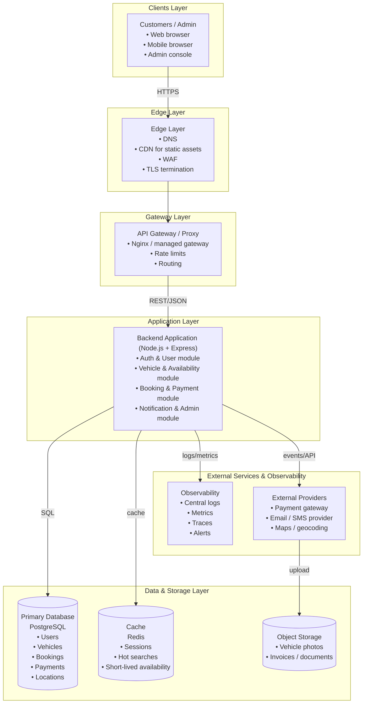

# Online Vehicle Rental — System Architecture

**Logical architecture | Initial release: modular monolith; scale-out path shown**

---

## Architecture Diagram

---

## Component Details

### 1. Customers / Admin
- Web browser
- Mobile browser
- Admin console

### 2. Edge Layer
- DNS
- CDN for static assets
- WAF (Web Application Firewall)
- TLS termination
- Communication: Inbound traffic over **HTTPS**

### 3. API Gateway / Proxy
- Nginx / managed gateway
- Rate limits
- Routing
- Communication: Routes requests to backend via **REST/JSON**

### 4. Backend Application
- **Stack**: Node.js + Express (Modular Monolith)
- **Modules**:
  - Auth & User module
  - Vehicle & Availability module
  - Booking & Payment module
  - Notification & Admin module

### 5. Primary Database
- **Engine**: PostgreSQL
- **Data Entities**: Users, Vehicles, Bookings, Payments, Locations
- **Interface**: SQL

### 6. Cache
- **Engine**: Redis
- **Purposes**: Sessions, hot searches, short-lived availability

### 7. External Providers
- Payment gateway
- Email / SMS provider
- Maps / geocoding
- Connected via events / REST APIs

### 8. Object Storage
- Stores vehicle photos and invoices/documents
- Assets uploaded via external providers / backend

### 9. Observability
- Central logs
- Metrics
- Traces
- Alerts

---

## Architectural Principles & Policies

- **Trust Boundaries**:
  - All client traffic uses HTTPS.
  - Application secrets stay server-side.
  - Payment card data is handled directly by the payment provider (never touches application servers).
- **Scale Path**:
  - Run multiple stateless API instances behind the gateway.
  - Add read replicas, message queues, and service extraction only when justified by traffic and complexity.
